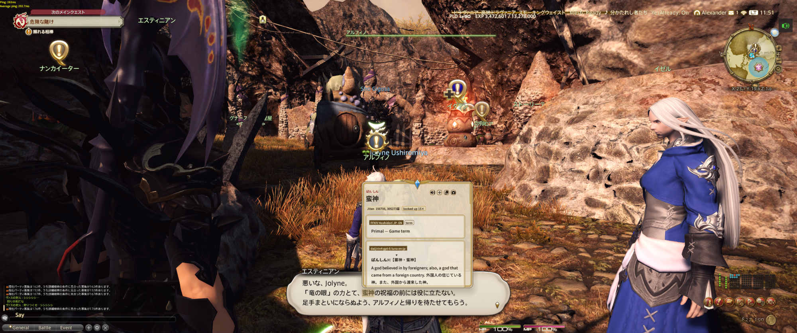

<div align="center">


# Hachidori for FFXIV

**Read Japanese as you play FFXIV.**<br>Hover dialogue, subtitles, battle talk, and chat for dictionary lookups, pronunciation, and Anki mining.

[](https://github.com/KonyAHS/HachidoriFfxiv/releases/latest) [](https://github.com/KonyAHS/HachidoriFfxiv/stargazers) [](https://github.com/KonyAHS/HachidoriFfxiv/actions/workflows/release.yml) [](#first-setup) [](LICENSE)

[Install](#first-setup) · [Features](#features) · [Popup themes](#popup-themes) · [FFXIV dictionary](dictionaries/ffxiv/README.md)

Windows plugin for Dalamud, installed through a custom repository.

</div>

[](docs/screenshots/dialogue-lookup.png)

The Crystal popup looks up **蛮神** (ばんしん) in dialogue and shows the FFXIV dictionary’s English term, **Primal**.

<details>
<summary>Open a sample dictionary entry</summary>

**冒険者** (ぼうけんしゃ) — adventurer

Once your Hachidori host is linked, try `/hachidori 冒険者` in game.

</details>

## Features

- **Hover lookups in the game's own text:** dialogue, cutscene subtitles, battle
  talk and the chat window, with no overlay on top of the game text.
- **Yomitan-style popups:** nested lookups inside definitions, whole-word hover,
  pitch accent, frequencies, deinflection and kanji info, using your Hachidori
  dictionaries.
- **Hachidori popup themes:** popups follow the theme picked in Hachidori
  (Default and its colour palettes, Nazeka, Plain, JL, Bee's Theme, Crystal with
  its Grey, Beige and Retro blue colours), your opacity and your custom popup CSS.
- **Pronunciation audio** from your Hachidori audio sources.
- **Anki mining** with your Hachidori template. Each chat message is its own sentence.
- **Reader and search windows:** an optional line history overlay and a search box.
- **Your character's name in katakana,** so it reads naturally in sentences and cards.
- **GSM text feed (opt-in):** sends dialogue and interaction popups to
  [GameSentenceMiner](https://github.com/bpwhelan/GameSentenceMiner).
- **NPC images:** crop screenshots into one picture dictionary on your host.
- **Optional FFXIV dictionary** of game names and vocabulary.

## First setup

1. Install [Hachidori for Chrome](https://github.com/bee-san/hachidori#install-in-15-seconds)
   and import your Japanese dictionaries. Use a recent version with Sharing support.
2. In Hachidori, open **Settings → Sharing → Download the Anki add-on**.
   Install [Hachidori Relay](https://github.com/bee-san/hachidori-anki#install) in
   Anki via **Tools → Add-ons → Install from file**, then restart Anki.
3. Keep Anki and Chrome open. In Hachidori **Settings → Sharing**, confirm
   **Sharing through Anki** is active and your dictionaries are available.
4. Launch FFXIV with [XIVLauncher/Dalamud](https://goatcorp.github.io/).
   In **Dalamud Settings → Experimental → Custom Plugin Repositories**, add:

   ```text
   https://github.com/KonyAHS/HachidoriFfxiv/releases/latest/download/pluginmaster.json
   ```

5. Save, open `/xlplugins`, search **Hachidori for FFXIV**, and install it.
6. Run `/hachidori config` and confirm a linked host and dictionary count.
   Local defaults are host `127.0.0.1`, relay port `8771`, and audio API port `19633`.
   Keep them unchanged for a same-computer setup.

The plugin uses your Hachidori host's dictionaries and templates; it is not a
standalone dictionary and a generic Yomitan API server is insufficient.
No compiling or manual DLL installation is needed.

## Use

- Hover Japanese game text to look up words. Move into a definition and hover
  another Japanese word for a nested lookup. Set **Scan key** in the Popup tab
  if you prefer holding Shift, Ctrl or Alt instead of plain hover.
- Run `/hachidori 冒険者` to try a lookup, `/hachidori search` for search, or
  `/hachidori reader` for the optional reader/history overlay.
- Use the pronunciation button for dictionary audio. For Anki, configure a
  template in Hachidori, select it in the plugin settings, then use **+** on an entry.
- The camera button lets you crop an NPC screenshot into your host. All pictures
  share one **FFXIV NPC pictures** dictionary; `/hachidori pictures` lists them,
  removes them, and merges the one-picture dictionaries made by older versions.
  Hachidori cannot edit an installed dictionary, so the plugin keeps the pictures
  in its config folder (`npc-pictures`) and replaces the whole dictionary on each
  change. This requires host support for linked dictionary imports.
- Optional: import [the FFXIV Japanese–English dictionary](dictionaries/ffxiv/README.md)
  into Hachidori for game names and vocabulary. **Contains expansion spoilers.**

## Popup themes

Popups use the theme selected in Hachidori **Settings → Design**. Run
`/hachidori config` and open the **Theme** tab to pick a different theme or
colours for the game only, use the plugin's original look, or add CSS that only
applies in FFXIV.

Hachidori's themes are web pages, so the plugin interprets their stylesheets
rather than running them: colours, backgrounds and vertical gradients, borders,
corner radius, padding, shadows, Crystal's frame and crest, headword and reading
colours and sizes, and CSS custom properties (`var()`) apply. Layout rules
(flex, grid, positioning), images in CSS, and theme JavaScript do not; the
popup keeps the plugin's layout. After a Hachidori update, refresh the bundled
stylesheets with `python -I scripts/sync_hachidori_themes.py <extension folder>`.

## Send text to GSM

GameSentenceMiner can read game text from a local WebSocket. This is off by
default, and the feed is only reachable from your own computer.

1. Run `/hachidori config`, open the **GSM** tab and enable **Publish text for GSM**.
2. Choose what to send:

   | Preset | Sends |
   | --- | --- |
   | Dialogue only | Dialogue, cutscene subtitles, battle talk |
   | Dialogue and popups (recommended) | The above, plus yes/no prompts and choice menus |
   | Everything, including chat | The above, plus your selected chat channels, including other players' messages |

   Changing any checkbox shows **Custom**. You can also put the speaker's name
   before each line.
3. Keep the default port `6677` if nothing else uses it. GSM's default sources
   already include `localhost:6677`, `localhost:2333` and `localhost:9001`, so no GSM
   setup is normally needed. If you change to another port, add it to GSM's
   WebSocket sources.
4. With GSM running, check that the tab shows a connected client, then use
   **Send test line**.

Each line is sent as JSON text: `{"sentence":"…"}`. Websites are refused, but local
pages and programs on your computer can connect.

## Troubleshooting and limits

- **No host:** keep Anki/Chrome running, check Hachidori Sharing, then use
  `/hachidori reconnect`. If needed, update Hachidori and the Relay add-on.
- **No popup:** check your scan key and enable **Show native hover targets (debug)**.
  Set the game's text language to Japanese. Unusual layouts/fonts may affect hover.
- **No chat popup:** check **Include native chat text** in the Popup tab and **Chat**
  in the Capture tab. If it still fails, attach `/hachidori logs` output to an issue.
  Lines containing icons can place the hover slightly off the character.
- **GSM not connecting:** the GSM tab reports a port in use; pick another slot.
- **No audio:** check port `19633` and pronunciation sources in Hachidori.
- **Old development build:** disable it before installing this version; `/hoshi`
  remains an alias, and old `Hoshidori.json` settings are migrated when possible.
- `/hachidori logs` exports diagnostics locally. Review exports before attaching
  them to an [issue](https://github.com/KonyAHS/HachidoriFfxiv/issues).

This is an early release. Native hover, chat hover, the GSM feed, cutscene layouts,
GPU screenshots and real Anki saves need in-game validation. Video OCR, game
voice-line recording, Anki screenshot/video attachments and arbitrary dictionary
CSS are unsupported. Lookups send the selected text to your configured Hachidori
host; mining and NPC image imports write to your Anki/Hachidori setup when requested.

## Credits

This plugin exists because of these open-source projects. They are separate works
under their own licenses, and their authors don't endorse or maintain this plugin.

**Works with**

- [Hachidori](https://github.com/bee-san/hachidori) and
  [Hachidori Relay](https://github.com/bee-san/hachidori-anki): dictionaries, lookups,
  templates and Anki mining all come from your Hachidori host.
- [hoshidicts](https://github.com/Manhhao/hoshidicts): the dictionary engine behind
  Hachidori, and the lookup format used here.
- [GameSentenceMiner](https://github.com/bpwhelan/GameSentenceMiner): the optional
  text feed is built to fit how GSM reads WebSocket sources.

**Built on**

- [Dalamud](https://github.com/goatcorp/Dalamud) and
  [XIVLauncher](https://github.com/goatcorp/FFXIVQuickLauncher): the plugin framework.
- [FFXIVClientStructs](https://github.com/aers/FFXIVClientStructs): the game UI
  structures used to read native text.
- [NAudio](https://github.com/naudio/NAudio),
  [NAudio.Vorbis](https://github.com/naudio/Vorbis),
  [NVorbis](https://github.com/NVorbis/NVorbis),
  [Concentus](https://github.com/lostromb/concentus) and
  [Concentus.Oggfile](https://github.com/lostromb/concentus.oggfile): audio playback.

**Inspiration and reference**

- [Yomitan](https://github.com/yomidevs/yomitan): popup design, dictionary format, and
  the furigana and pitch accent logic this plugin's versions follow.
- [JL](https://github.com/rampaa/JL): hover scanning behaviour.
- [TextToTalk](https://github.com/karashiiro/TextToTalk): the Dalamud text-to-speech
  plugin, an example of serving game text over a local WebSocket.

Dictionary data has [its own sources and attribution](dictionaries/ffxiv/README.md#sources-and-attribution),
including [XIVAPI's datamining tables](https://github.com/xivapi/ffxiv-datamining).
Bundled library licenses are in the [third-party notices](THIRD-PARTY-NOTICES.txt).

[Build and release](docs/DEVELOPMENT.md) · [License](LICENSE) ·
[Third-party notices](THIRD-PARTY-NOTICES.txt)

Plugin source: GPL-3.0-or-later. FFXIV names, text and images retain their original
rights; see the dictionary's attribution. Not affiliated with Square Enix.
