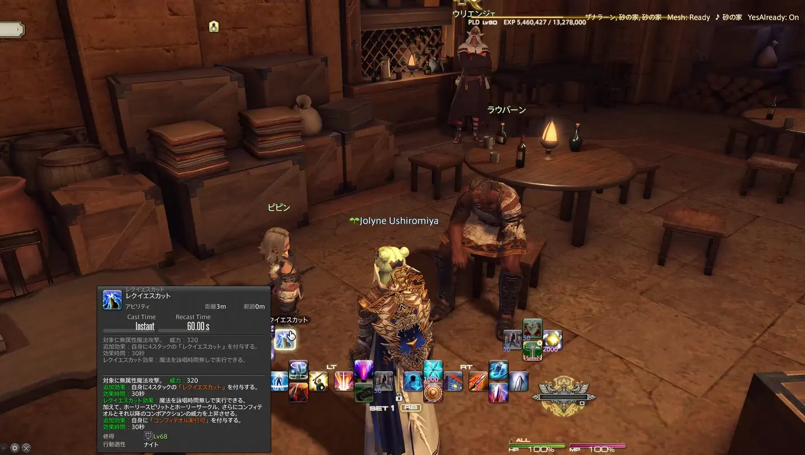
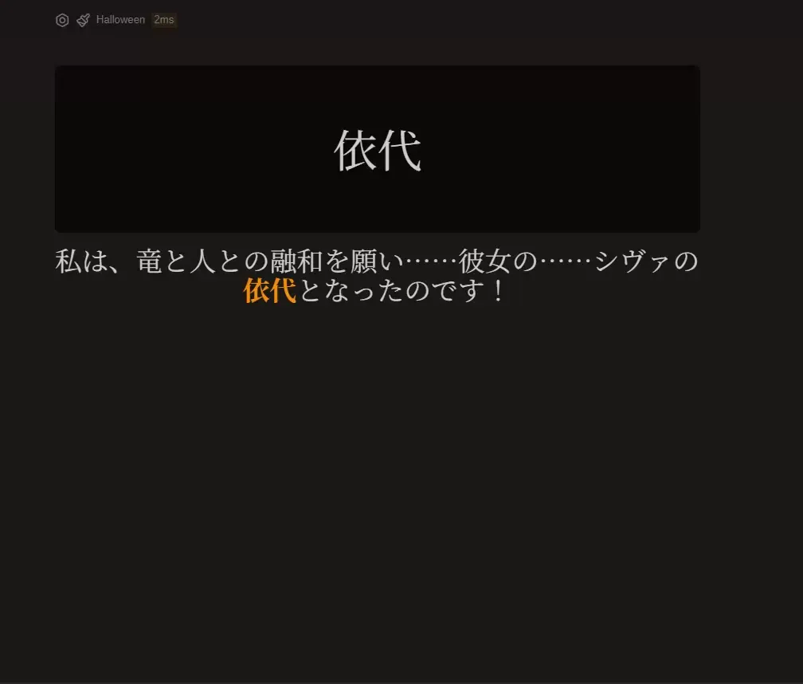
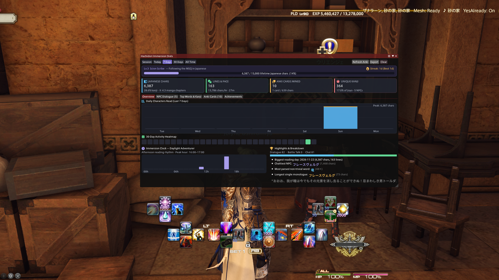

<div align="center">


# Hachidori for FFXIV

**Read Japanese as you play FFXIV.**<br>
Hover dialogue, subtitles, battle talk, chat, and frozen tooltips for Hachidori popups, audio, immersion stats, and one-click Anki mining with game media.

[](https://github.com/KonyAHS/HachidoriFfxiv/releases/latest) [](https://github.com/KonyAHS/HachidoriFfxiv/releases/latest/download/FFXIV-Hachidori-JP-EN.zip) [](https://github.com/KonyAHS/HachidoriFfxiv/stargazers) [](https://github.com/KonyAHS/HachidoriFfxiv/actions/workflows/release.yml) [](#first-setup) [](LICENSE)

[First Setup](#first-setup) · [Features](#features) · [Modes](#live-offline--gsm) · [Commands](#commands) · [Docs](#documentation) · [Credits](#credits)

Dalamud plugin for FFXIV on **Windows**, with automatic fallbacks for **Linux, Steam Deck, and macOS**.

</div>

<p align="center">
  <a href="docs/screenshots/webview-popup.png">
    
  </a>
</p>

---

## First Setup

1. **Install Hachidori for Chrome** — Follow [Hachidori's install guide](https://github.com/bee-san/hachidori#install-in-15-seconds) and import your Japanese dictionaries.
   - *Optional:* Download and import [`FFXIV-Hachidori-JP-EN.zip`](https://github.com/KonyAHS/HachidoriFfxiv/releases/latest/download/FFXIV-Hachidori-JP-EN.zip) (37,729 game terms & 190 portraits — **contains expansion spoilers**).
2. **Install Hachidori Relay in Anki** — In Hachidori, open **Settings → Sharing → Download the Anki add-on**, install [Hachidori Relay](https://github.com/bee-san/hachidori-anki#install) in Anki (**Tools → Add-ons → Install from file**), then restart Anki.
3. **Confirm Sharing** — Keep Chrome and Anki open and verify **Sharing through Anki** is active in Hachidori **Settings → Sharing**.
4. **Add the Dalamud Repository** — In FFXIV (**Dalamud Settings → Experimental → Custom Plugin Repositories**), add:

   ```text
   https://github.com/KonyAHS/HachidoriFfxiv/releases/latest/download/pluginmaster.json
   ```

5. **Install & Verify** — Save, open `/xlplugins`, install **Hachidori for FFXIV**, and run `/hachidori config` to confirm a linked host and dictionary count.

> Uses your Hachidori dictionaries and templates directly (not a standalone dictionary or generic Yomitan API). Local defaults work out of the box on one PC.

---

## Features

**Native Hover Lookups & Real Hachidori Popups** — Hover directly over dialogue, subtitles, battle talk, and chat with no text overlay. Renders Hachidori's real browser popup inside FFXIV (with automatic ImGui fallback on Linux/macOS), complete with nested lookups, pitch accent, frequencies, kanji info, and audio. *(Shown above.)*

**Freeze Frame for Tooltips (`Ctrl + Shift + F`)** — Freezes the screen and visible item, skill, and status tooltips so you can hover and mine them without them vanishing.

<a href="docs/screenshots/freeze-frame.webp"></a>

**One-Click Anki Mining with Game Media** — Mine cards using your Hachidori template with clean game screenshots (plugin UI hidden), recorded voice lines or local TTS, animated clips, and AI sentence translations — no GSM required.

<a href="docs/screenshots/anki-card.webp"></a>

**Controller & Touchpad Mode (`/hachidori pad`)** — Read and mine from the couch using D-pad word stepping, a left-stick or DualSense/DS4 touchpad virtual cursor, nested popup diving, and remappable bindings.

<a href="docs/screenshots/controller-mode.webp"></a>

**Immersion Stats & Anki Card Feed (`/hachidori stats`)** — Track reading pace, streaks, rank, heatmaps, chattiest NPCs, frequent & most-looked-up ("Nemesis") words, kanji encountered, and recent Anki cards.

<a href="docs/screenshots/immersion-stats.png"></a>

**Also included:**
- **Offline mode** — Keep looking up words, playing audio, and mining to Anki with Chrome closed.
- **Reader, search, katakana character name & NPC pictures** — Optional line-history overlay, manual search, natural player name readings, and in-game NPC portrait cropping (`/hachidori pictures`).
- **FFXIV JP–EN dictionary** — Optional 37,729-entry dictionary for patch 7.58 with 190 portraits ([guide & sources](dictionaries/ffxiv/README.md)).

---

## Live, Offline & GSM

Live Hachidori is used whenever Chrome is linked. Enable **Offline Mode** in `/hachidori config` → **Connection** to play without Chrome, or enable the opt-in **GSM** WebSocket feed if you already use [GameSentenceMiner](https://github.com/bpwhelan/GameSentenceMiner).

| Capability | Live (Default) | Offline Mode | Optional GSM Feed |
| --- | :---: | :---: | :---: |
| Chrome required | Yes | No *(auto-syncs on link)* | Optional |
| Lookups, furigana, pitch, kanji | Yes | Yes | — |
| Pronunciation audio | All Hachidori sources | URL / JSON sources | — |
| Anki mining & clean screenshots | Yes | Yes *(basic templates)* | Via GSM |
| Voice recording, TTS & animated clips | Built-in | Built-in | Via GSM |
| AI sentence translation | Built-in | Built-in | Via GSM |
| NPC picture edits | Yes | Needs Chrome | — |
| Local WebSocket text hook | — | — | Opt-in (`:6677`) |

---

## Commands

`/hoshi` also works as an alias.

| Command | Action |
| --- | --- |
| `/hachidori` or `/hachidori config` | Open Settings (with Quick Guide & settings search) |
| `/hachidori <text>` | Look up Japanese text directly |
| `/hachidori freeze` | Freeze screen & tooltips (`Ctrl + Shift + F`) |
| `/hachidori stats` | Open Immersion Stats & Anki Card Feed |
| `/hachidori pad` | Toggle Controller reading mode |
| `/hachidori reader` | Toggle optional line-history Reader overlay |
| `/hachidori search` | Toggle manual Search window |
| `/hachidori pictures` | Manage custom NPC picture dictionary |
| `/hachidori reconnect` | Reconnect to Hachidori Relay |
| `/hachidori logs` | Export redacted diagnostic log |
| `/hachidori help` | List these commands in chat |

---

## Documentation

Want to dig into configuration, platform fallbacks, or building from source?

- **[Feature Guide](docs/FEATURES.md)** — WebView2 & ImGui popups, Freeze Frame, Offline mode, Card media & AnkiConnect fields, Controller bindings, NPC pictures, and GSM WebSocket setup.
- **[OS & Steam Deck Compatibility](docs/COMPATIBILITY.md)** — Windows, Linux, Steam Deck, and macOS feature matrix and Steam Deck workflow tips.
- **[FFXIV Custom Dictionary](dictionaries/ffxiv/README.md)** — Dictionary contents, installation, sources, and generator code.
- **[Performance & Resource Use](docs/PERFORMANCE.md)** — Memory, CPU, GPU, disk and network cost of each feature, and lighter setups for low-end PCs and Steam Deck.
- **[Troubleshooting & Limits](docs/TROUBLESHOOTING.md)** — Common fixes, diagnostics, and privacy scope.
- **[Changelog](CHANGELOG.md)** — Feature log for every release.
- **[Build & Release](docs/DEVELOPMENT.md)** — Building `hdw_native.dll`, parity tests, and packaging.

---

## Credits

This plugin builds on these open-source projects (separate works under their own licenses, unaffiliated with this plugin):

- **Works with:** [Hachidori](https://github.com/bee-san/hachidori) & [Hachidori Relay](https://github.com/bee-san/hachidori-anki) (dictionaries, web frontend, mining), [hoshidicts](https://github.com/Manhhao/hoshidicts) / [bee-san/hoshidicts](https://github.com/bee-san/hoshidicts) (lookup engine & reading tables), and [GameSentenceMiner](https://github.com/bpwhelan/GameSentenceMiner) (optional text feed & translation import).
- **Built on:** [Dalamud](https://github.com/goatcorp/Dalamud) & [XIVLauncher](https://github.com/goatcorp/FFXIVQuickLauncher), [FFXIVClientStructs](https://github.com/aers/FFXIVClientStructs), [Microsoft Edge WebView2](https://developer.microsoft.com/en-us/microsoft-edge/webview2/), and [NAudio](https://github.com/naudio/NAudio) / [NVorbis](https://github.com/NVorbis/NVorbis) / [Concentus](https://github.com/lostromb/concentus) for audio.
- **Inspired by:** [Yomitan](https://github.com/yomidevs/yomitan), [JL](https://github.com/rampaa/JL), and [TextToTalk](https://github.com/karashiiro/TextToTalk).

Dictionary data has [its own attribution](dictionaries/ffxiv/README.md#sources-and-attribution) (including [XIVAPI's datamining tables](https://github.com/xivapi/ffxiv-datamining)). Bundled library licenses are in [THIRD-PARTY-NOTICES.txt](THIRD-PARTY-NOTICES.txt).

Plugin source: **GPL-3.0-or-later** ([LICENSE](LICENSE)). FFXIV names, text, and images retain their original rights. Not affiliated with Square Enix.
