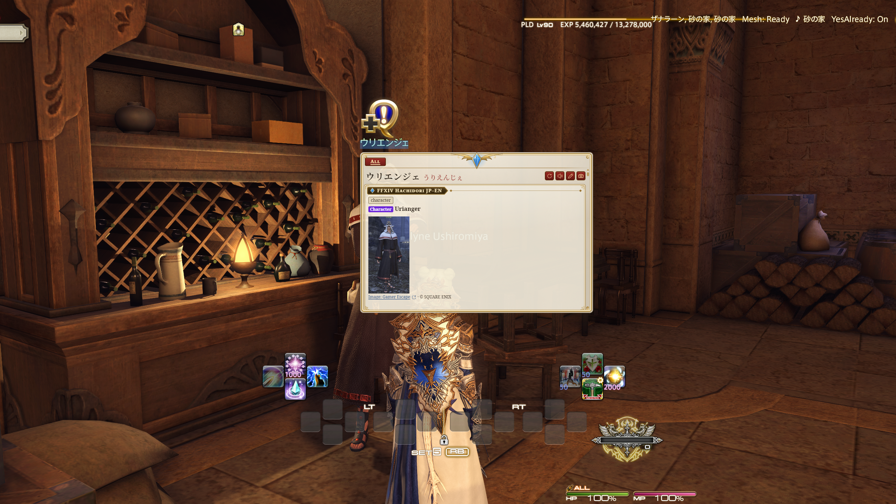
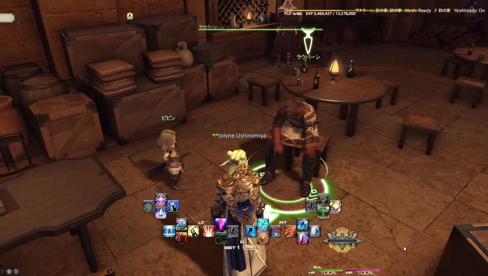

<div align="center">


# Hachidori for FFXIV

**Read Japanese as you play FFXIV.**<br>Hover dialogue, subtitles, battle talk, chat, and frozen tooltips for Hachidori dictionary popups, pronunciation, immersion stats, and Anki mining with game media.

[](https://github.com/KonyAHS/HachidoriFfxiv/releases/latest) [](https://github.com/KonyAHS/HachidoriFfxiv/releases/latest/download/FFXIV-Hachidori-JP-EN.zip) [](https://github.com/KonyAHS/HachidoriFfxiv/stargazers) [](https://github.com/KonyAHS/HachidoriFfxiv/actions/workflows/release.yml) [](#first-setup) [](LICENSE)

[Install](#first-setup) · [FFXIV dictionary](#ffxiv-custom-dictionary) · [OS & Steam Deck](#os-and-steam-deck-compatibility) · [Features](#features) · [Popups & themes](#popups-and-themes) · [Freeze Frame](#freeze-frame-for-tooltips) · [Immersion stats](#immersion-stats) · [Card media](#card-media-screenshot-voice-line-animation-translation) · [Controller](#controller) · [Offline mode](#offline-mode)

Dalamud plugin for FFXIV, installed through a custom repository. Built for Windows with automatic compatibility fallbacks for Linux, Steam Deck, and macOS.

</div>

[](docs/screenshots/dialogue-lookup.png)

The Crystal popup looks up **蛮神** (ばんしん) in dialogue and shows the FFXIV dictionary’s English term, **Primal**.

<details>
<summary>Open a sample dictionary entry</summary>

**冒険者** (ぼうけんしゃ) — adventurer

Once your Hachidori host is linked, try `/hachidori 冒険者` in game.

</details>

## Features

- **Hover lookups directly on the game's own text:** dialogue, cutscene subtitles,
  battle talk, the chat window (scroll-aware and per-panel), and optionally other
  native UI windows, with no overlay covering the game text.
- **Real Hachidori Web popups (WebView2) with full upstream parity:** renders
  Hachidori's actual browser popup UI inside FFXIV via a click-through overlay
  without stealing focus — exact upstream themes, variants, custom CSS, pitch
  accent graphs, frequencies, deinflection, SVG and dictionary images, kanji info,
  and nested lookups. Automatically syncs with your Hachidori version and falls
  back cleanly to the built-in ImGui renderer whenever needed.
- **Freeze Frame for tooltips (`Ctrl + Shift + F`):** freezes the screen and every
  visible Japanese text block — including item, skill, and status tooltips — so
  you can hover and mine tooltip text without it vanishing.
- **Pronunciation audio** from your Hachidori audio sources (including direct
  Audio URL and Yomitan JSON sources offline).
- **Anki mining with built-in game media, no GSM needed:** one-click mining using
  your Hachidori template (live or offline), with clean game screenshots, recorded
  in-game voice lines (or local TTS for unvoiced lines), animated AVIF/WebP/GIF
  clips, and AI sentence translations with surrounding dialogue context.
- **Immersion stats & Anki card feed (`/hachidori stats`):** tracks characters
  read, reading pace, streaks, FFXIV immersion rank, daily charts, 30-day heatmap,
  24-hour Immersion Clock, chattiest NPCs, hoverable NPC dialogue history, most
  parsed & most looked-up ("Nemesis") words, kanji encountered, achievements, and
  recent Anki cards (in-game + AnkiConnect), with JSON export.
- **Controller reading mode (`/hachidori pad`):** read and mine from the couch
  with D-pad word/character stepping, left-stick virtual cursor, optional
  DualSense/DS4 touchpad cursor, nested popup diving, UI window cycling,
  PlayStation/Xbox button labels, and remappable button bindings.
- **Reader, search, and searchable settings:** optional line-history reader
  overlay, manual search window, guided onboarding, and a full-text Settings
  search bar.
- **Your character's name in katakana,** automatically or with a custom reading,
  so it reads naturally in sentences, TTS, and cards.
- **NPC picture dictionary (`/hachidori pictures`):** crop in-game screenshots
  into a single **FFXIV NPC pictures** dictionary on your Hachidori host.
- **Optional offline mode:** keep looking up words, playing audio, and mining to
  Anki with Chrome closed, from a local synced copy of your Hachidori dictionaries.
- **Opt-in GSM text feed:** publishes game text over a local WebSocket for
  [GameSentenceMiner](https://github.com/bpwhelan/GameSentenceMiner).
- **Optional FFXIV JP–EN dictionary:** 37,729 entries (patch 7.58) covering NPCs,
  enemies, locations, actions, status effects, Party Finder/raiding slang, and 190
  embedded character and location portraits.

## First setup

1. Install [Hachidori for Chrome](https://github.com/bee-san/hachidori#install-in-15-seconds)
   and import your Japanese dictionaries. Use a recent version with Sharing support.
2. In Hachidori, open **Settings → Sharing → Download the Anki add-on**.
   Install [Hachidori Relay](https://github.com/bee-san/hachidori-anki#install) in
   Anki via **Tools → Add-ons → Install from file**, then restart Anki.
3. Keep Anki and Chrome open. In Hachidori **Settings → Sharing**, confirm
   **Sharing through Anki** is active and your dictionaries are available.
4. Launch FFXIV with [XIVLauncher/Dalamud](https://goatcorp.github.io/).
   In **Dalamud Settings → Experimental → Custom Plugin Repositories**, add:

   ```text
   https://github.com/KonyAHS/HachidoriFfxiv/releases/latest/download/pluginmaster.json
   ```

5. Save, open `/xlplugins`, search **Hachidori for FFXIV**, and install it.
6. Run `/hachidori config` (the **Quick Guide** tab opens automatically on first
   run) and confirm a linked host and dictionary count. Local defaults are host
   `127.0.0.1`, relay port `8771`, and audio API port `19633`. Keep them unchanged
   for a same-computer setup.

The plugin uses your Hachidori host's dictionaries and templates; it is not a
standalone dictionary and a generic Yomitan API server is insufficient.
No compiling or manual DLL installation is needed.

## Use

Hover Japanese game text to look up words. Move into a definition and hover
another Japanese word for a nested lookup. Set **Scan key** in the **Popup** tab
if you prefer holding Shift, Ctrl, or Alt instead of plain hover.

| Command | What it does |
| --- | --- |
| `/hachidori` or `/hachidori config` | Open Settings (with Quick Guide and full settings search) |
| `/hachidori <text>` | Look up Japanese text directly in the Search window |
| `/hachidori freeze` | Freeze the screen & tooltips for scanning (or press `Ctrl + Shift + F`) |
| `/hachidori stats` | Open the Immersion Stats & Anki Card Feed dashboard |
| `/hachidori search` | Open the manual Search & hover window |
| `/hachidori reader` | Pin or unpin the optional dialogue Reader & history overlay |
| `/hachidori pad` | Toggle Controller reading mode (ideal on a cross hotbar macro) |
| `/hachidori pictures` | Manage your custom FFXIV NPC picture dictionary |
| `/hachidori reconnect` | Reconnect to your Hachidori Relay host |
| `/hachidori logs` | Export a local redacted diagnostic log |

`/hoshi` also works as an alias.

- Use the pronunciation button for dictionary audio. For Anki, configure a
  template in Hachidori, select it in the plugin settings, then use **+** on an entry.
- The camera button lets you crop an NPC screenshot into your host. All pictures
  share one **FFXIV NPC pictures** dictionary; `/hachidori pictures` lists them,
  removes them, and merges the one-picture dictionaries made by older versions.
  Hachidori cannot edit an installed dictionary, so the plugin keeps the pictures
  in its config folder (`npc-pictures`) and replaces the whole dictionary on each
  change. This requires host support for linked dictionary imports.
- Optional: download [`FFXIV-Hachidori-JP-EN.zip`](https://github.com/KonyAHS/HachidoriFfxiv/releases/latest/download/FFXIV-Hachidori-JP-EN.zip)
  (or click **Download FFXIV Dictionary (.zip)** inside `/hachidori config`) and
  import it into Hachidori — see [FFXIV custom dictionary](#ffxiv-custom-dictionary)
  below. **Contains expansion spoilers.**

## FFXIV custom dictionary

This repository also publishes **FFXIV Hachidori JP–EN** — a Yomitan/Hachidori v3
dictionary ZIP built specifically for FFXIV (patch **7.58**, **37,729 entries**,
**190 embedded character and location portraits**), covering NPCs & aliases,
enemies, locations, jobs, duties, actions, status effects, Auto-Translate
phrases, and Japanese Party Finder/raiding lingo.

- **Direct download:** [`FFXIV-Hachidori-JP-EN.zip`](https://github.com/KonyAHS/HachidoriFfxiv/releases/latest/download/FFXIV-Hachidori-JP-EN.zip)
- **Guide, sources & generator code:** [`dictionaries/ffxiv/`](dictionaries/ffxiv/README.md)
- **In-game shortcut:** open `/hachidori config` (**Quick Guide** or **Connection** tab) and click **Download FFXIV Dictionary (.zip)** to open the download directly in your browser.

To install, open Hachidori (or Yomitan) **Settings → Dictionaries**, import
`FFXIV-Hachidori-JP-EN.zip`, and place it above your general Japanese
dictionaries. **Contains character names and portraits from all expansions.**

## Popups and themes

[](docs/screenshots/webview-popup.png)

By default, popups render **Hachidori's real browser UI** inside FFXIV using
Microsoft Edge WebView2 over a permanently click-through DirectComposition
overlay (so clicking or scrolling a popup never steals OS focus from FFXIV):

- **Full upstream parity:** every theme in Hachidori **Settings → Design**
  (Default and its colour palettes, Nazeka, Plain, JL, Bee's Theme, Crystal with
  Grey/Beige/Retro Blue, and any future upstream themes), opacity, custom popup
  CSS, pitch accent graphs, and dictionary images/SVGs render exactly as they do
  in Chrome.
- **Automatic bundle sync:** the plugin keeps a cached copy of Hachidori's web
  frontend matched to your linked host version, checking your local
  Chrome/Edge/Brave/Vivaldi extension install first and downloading from
  `bee-san/hachidori` GitHub Releases otherwise, with automatic rollback to the
  last verified version if a bundle fails to boot.
- **In-game overrides:** open `/hachidori config` → **Theme** to pick a different
  theme or variant for FFXIV only, add FFXIV-only CSS, point to a custom extension
  folder, or click **Sync Hachidori Web now**.
- **Built-in ImGui fallback:** if Microsoft Edge WebView2 Runtime is not installed,
  while the bundle is syncing, or if you switch off **Hachidori Web** in the
  **Theme** tab, the plugin seamlessly falls back to its built-in ImGui popup
  renderer (which interprets bundled theme stylesheets for colours, gradients,
  borders, shadows, Crystal's frame/crest, and headword styling). After an
  upstream theme update, maintainers can refresh the fallback stylesheets with
  `python -I scripts/sync_hachidori_themes.py <extension folder>`.

## Freeze Frame for tooltips

[](docs/screenshots/freeze-frame.webp)

FFXIV hover tooltips (items, actions, traits, statuses) normally vanish as soon
as you move the mouse away to scan their text. **Freeze Frame** solves this:

1. Hover any item, skill, or UI element so its Japanese tooltip is visible.
2. Press **`Ctrl + Shift + F`** (or run `/hachidori freeze`). The hotkey can be
   changed in **Popup → Freeze Frame hotkey** (`Ctrl + Shift + F`, `Alt + F`,
   `Ctrl + Space`, `Pause / Break`, `F9`, `Shift + Middle Click`, or command-only).
3. The plugin captures a snapshot of the screen and every visible native Japanese
   text block — prioritizing tooltips (`ItemDetail`, `ActionDetail`, `Tooltip`,
   and other `*Detail` / `*Tooltip` windows).
4. Freely hover any word on the frozen tooltip to open popups, hear pronunciation,
   or mine to Anki. Use the top pill to toggle tooltip highlight boxes
   (**Show/Hide Boxes**), copy the tooltip text into `/hachidori search`
   (**Send to Search**), or exit.
5. Press **`Esc`**, right-click outside any popup, or press the hotkey again to
   return to the game immediately.

## Immersion stats

[](docs/screenshots/immersion-stats.png)

Run `/hachidori stats` (or click **Stats** in the Settings header bar) to track
your Japanese reading and mining progress in FFXIV across **Session**, **Today**,
**7 Days**, **30 Days**, and **All Time**:

- **Rank, streaks & KPIs:** FFXIV immersion rank with lifetime character XP bar,
  current and best daily reading streaks, total Japanese characters (with kanji %
  and reading equivalents), lines & pace (chars/hr and active time), Anki cards
  mined, and unique kanji encountered (% of Joyo kanji).
- **Overview:** daily characters bar chart (marking days you mined cards), 30-day
  activity heatmap, 24-hour Immersion Clock with reading persona, and source
  breakdown (Dialogue, Battle Talk, Chat).
- **NPC Dialogue:** chattiest NPCs leaderboard (click any NPC to open their
  dictionary entry and portrait) plus a filterable Recent NPC Dialogue Feed where
  every line is directly hoverable for lookups and mining.
- **Top Words & Kanji:** **Most Parsed Non-Trivial Words** (automatically filters
  out particles, pronouns, auxiliaries, and single kana), **Most Looked Up /
  Nemesis Words** (great candidates to mine), and a clickable **Kanji Encountered**
  grid.
- **Anki Cards:** browse cards mined in FFXIV (with `IMG`, `AUDIO`, `ANIM`, and
  `TL` media badges, pitch/frequency, hoverable sentence, and **Open in Anki**)
  or switch to the live **Latest from AnkiConnect** feed (with 7-day / 30-day
  totals).
- **Achievements & Export:** unlock immersion milestones as you read and mine, or
  export your complete stats history to JSON.

## Offline mode

By default every lookup goes to Hachidori in Chrome. Offline mode keeps a copy
of your dictionaries and Hachidori settings in the plugin's config folder, so
lookups keep working when Chrome is closed. Offline lookups need nothing else
running; setting up and syncing need Hachidori linked through Anki as usual.

1. With Hachidori linked, run `/hachidori config`, open **Connection**, and
   choose **Set up offline mode** (or use the button in **Quick Guide**). Your
   dictionaries download once (about as much disk space as Hachidori uses for them).
2. Live Hachidori is always used while it is linked. Each time it links again,
   the plugin compares dictionary revisions and downloads only what changed, and
   removes dictionaries you deleted in Hachidori. Settings such as dictionary
   order, theme, and audio sources are saved as you change them.
3. The **Connection** tab shows which backend is answering lookups, the disk space
   used, the last sync, and **Turn off and delete offline data**.

Offline lookups use the same engine (`hdw_native.dll`) and settings as Hachidori,
so results match the browser's. Anki mining also works offline: the plugin fills
your Hachidori Anki Template itself and adds the note through AnkiConnect, with
pronunciation, the game screenshot, and dictionary images. It checks duplicates
with Anki's own first-field check rather than Hachidori's word index, and leaves
Templates that overwrite existing notes, use Smaller Anki cards, or pitch graph
markers to Chrome. Offline, pronunciation uses your Audio URL and Yomitan JSON
sources directly (browser speech needs Chrome), lookup counts are recorded once
Hachidori is linked again, and NPC pictures need Chrome. The plugin warns when
your Hachidori is newer than its built-in engine; a dictionary in a format it
cannot read stays live-only until the plugin updates.

## Controller

[](docs/screenshots/controller-mode.webp)

Read dialogue and UI windows with a controller: move word by word or glide a
virtual cursor over any visible text, open the dictionary at it, and mine with
one button. FFXIV uses every button, so this is a mode: while it is on, the
controller drives Hachidori and the game ignores it; leave it to play again.

- **Enter:** put a macro with `/hachidori pad` on a cross hotbar slot (FFXIV
  handles that press so nothing else triggers), or hold **Back / Select**
  (changeable in `/hachidori config` → **Controller**).
- **Navigate:**
  - **Left stick:** glides a virtual cursor across any visible dialogue or UI
    window text (cursor speed adjustable under Advanced).
  - **DualSense / DualShock 4 touchpad (optional):** enable in the **Controller**
    tab to steer the virtual cursor with the touchpad.
  - **D-pad:** moves word by word (◀▶) and line by line (▲▼).
  - **Right stick:** scrolls the popup.
- **Default actions** (Xbox / PlayStation labels; all action buttons are
  remappable under **Controller → Advanced**):
  - **A / ✕:** add the selected entry to Anki
  - **X / □:** play pronunciation audio
  - **LT / RT (L2 / R2):** previous / next dictionary entry
  - **RB / R1:** dive into the popup for a nested lookup
  - **LB / L1:** cycle between open UI windows (or back out of a nested popup)
  - **Y / △:** toggle between word mode and character mode
  - **B / ○:** back out of a nested popup, or leave the mode
  - **Back / Start (Select / Options):** leave the mode
- Toggle **PlayStation button names** in the **Controller** tab to match your pad.
- The mode ends automatically when dialogue closes (configurable).
- Blocking the game's input requires **"plugin gamepad input"** enabled in
  Dalamud's settings; the hint bar warns if it is off.

## Card media: screenshot, voice line, animation, translation

[](docs/screenshots/anki-card.webp)

Cards you add with **+** can get media straight from the game, with no GSM
required. Settings are in `/hachidori config` → **Mining**.

- **Screenshot:** fills `{screenshot}` in your Hachidori Anki Template. Plugin
  windows (the popup, the reader, stats) are never in the picture.
- **Voice line:** records only FFXIV's own sound on Windows 10 2004+, and
  automatically falls back to standard system-output audio loopback on Linux /
  Steam Deck (Wine/Proton/PipeWire) and older Windows 10. Trims the clip to
  detected speech and adds one second of padding before and after. Lower the
  in-game BGM volume (and other desktop audio when using system loopback) for
  cleaner clips.
- **TTS for unvoiced lines:** when a line had no voice (or on macOS where
  CoreAudio has no built-in loopback), the sentence can be spoken by a local
  engine with VOICEVOX's API (VOICEVOX, AivisSpeech, …) or any custom URL that
  returns audio.
- **Animation:** captures a few seconds of the scene from when the line appeared
  (default 720 px, 12 fps, 3 s) as animated **AVIF** (smallest, best quality),
  **WebP**, or **GIF**. AVIF and WebP use FFmpeg, which the plugin finds on
  `PATH`, in GSM's folder, or on standard Linux/macOS host paths under Wine;
  without it you automatically get a built-in GIF.
- **Sentence translation:** uses GSM's translation prompt and settings with nearby
  dialogue as context, via **Gemini**, **Groq**, **OpenAI-compatible APIs**,
  **Ollama**, **LM Studio**, **Z.ai**, or **DeepL**, as well as your local
  **Codex** or **Claude Code** CLI login. **Import from GSM** copies your
  provider, models, keys, prompts, and Anki field in one click.

Voice lines, TTS audio, animations, and translations are added to the note through
the [AnkiConnect](https://ankiweb.net/shared/info/2055492159) add-on right after
Hachidori creates it. They go to fields named like *Sentence Audio*, *GIF*, and
*SentenceTranslation* (without a GIF field, the animation replaces the screenshot
in your picture field). You can customize all field names with **Advanced settings**.

## Send text to GSM

You no longer need GSM for screenshots, audio, animations, or translation (see
above). If you still use it, GameSentenceMiner can read game text from a local
WebSocket. This is off by default, and the feed is only reachable from your own
computer.

1. Run `/hachidori config`, enable **Advanced settings** (if the **GSM** tab is
   hidden), open **GSM**, and enable **Publish text for GSM**.
2. Choose what to send:

   | Preset | Sends |
   | --- | --- |
   | Dialogue only | Dialogue, cutscene subtitles, battle talk |
   | Dialogue and popups (recommended) | The above, plus yes/no prompts and choice menus |
   | Everything, including chat | The above, plus your selected chat channels, including other players' messages |

   Changing any checkbox shows **Custom**. You can also put the speaker's name
   before each line.
3. Keep the default port `6677` if nothing else uses it. GSM's default sources
   already include `localhost:6677`, `localhost:2333`, and `localhost:9001`, so no
   GSM setup is normally needed. If you change to another port, add it to GSM's
   WebSocket sources.
4. With GSM running, check that the tab shows a connected client, then use
   **Send test line**.

Each line is sent as JSON text: `{"sentence":"…"}`. Websites are refused, but local
pages and programs on your computer can connect.

## OS and Steam Deck compatibility

FFXIV + Dalamud is primarily developed and tested on **Windows 10 (2004+) / Windows 11**, where every feature works natively. On **Linux** (XIVLauncher.Core / Wine / Proton), **Steam Deck** (SteamOS), **macOS** (XIV on Mac / Wine / CrossOver), and **older Windows 10**, the plugin automatically detects your environment and enables built-in fallbacks where Windows-only APIs are unavailable.

> **Disclaimer:** Non-Windows platforms (Linux, Steam Deck, macOS) run FFXIV and Dalamud through Wine/Proton compatibility layers and are supported on a best-effort basis. The **Quick Guide** tab in `/hachidori config` shows your detected environment and any active fallbacks.

| Feature | Windows 10 (2004+) / 11 | Linux / Steam Deck (XIVLauncher.Core) | macOS (XIV on Mac) | Automatic fallback |
| --- | --- | --- | --- | --- |
| **Native hover, chat, stats, reader, search, Anki mining** | Full | Full | Full | — |
| **Popup rendering** | Hachidori Web (WebView2) | Built-in ImGui renderer | Built-in ImGui renderer | Automatically skips WebView2/DirectComposition on Wine & Gamescope (or if WebView2 Runtime is missing) and renders all bundled Hachidori themes via ImGui |
| **Offline mode (`hdw_native.dll`)** | Full | Full | Full | Statically linked CRT (no VC++ redist required); falls back to live Hachidori if loading fails |
| **Freeze Frame (tooltips)** | Full (`Ctrl + Shift + F`) | Full (`/hachidori freeze` or hotkey; `B`/`○` exits) | Full | Dim readable text cards if GPU viewport capture is unavailable; `KeyState` fallback under Wayland/Gamescope |
| **Voice line recording** | FFXIV-only (process loopback) | System output audio (PipeWire / PulseAudio loopback) | Unavailable by default (CoreAudio has no native loopback) | Falls back from process loopback → standard WASAPI system loopback → optional local TTS (VOICEVOX / custom) |
| **Pronunciation audio** | Ogg/Opus/WAV + Media Foundation (MP3/AAC) via WASAPI | Ogg/Opus/WAV built-in; MP3/AAC via host FFmpeg if Wine MF fails | Ogg/Opus/WAV built-in; MP3/AAC via host FFmpeg if Wine MF fails | Media Foundation → piped FFmpeg fallback; WASAPI output → WinMM (`waveOut`) fallback |
| **Screenshots & animations** | JPEG + FFmpeg AVIF/WebP or GIF | JPEG + host FFmpeg AVIF/WebP or GIF | JPEG + host FFmpeg AVIF/WebP or GIF | Auto-detects Windows & host Linux/macOS FFmpeg; falls back to built-in pure-C# GIF encoder |
| **Controller reading mode (`/hachidori pad`)** | Full (+ DualSense/DS4 HID touchpad) | Full (+ Steam Deck trackpads via Steam Input mouse) | Full | Left stick, D-pad, and mouse/trackpad virtual cursor work everywhere; Windows HID touchpad safely disabled if unsupported |

### Steam Deck & Linux tips

- **Recommended Steam Deck workflow (Gaming Mode):** Open native Linux **Anki** (with Hachidori Relay) and **Chrome** (with Hachidori) once in **Desktop Mode**, launch FFXIV, confirm the link in `/hachidori config`, and enable **Offline Mode** in the **Connection** tab. Once synced, lookups and pronunciation audio keep working in **Gaming Mode** with Chrome closed (open Anki when you want to mine new cards).
- **Localhost sharing:** Wine/Proton shares `127.0.0.1` with the Linux/macOS host (including standard Flatpak Anki/Chrome installs), so keep default host `127.0.0.1` and ports `8771`, `19633`, `8765`.
- **Cross-hotbar macros:** Bind `/hachidori pad` (Controller reading mode) and `/hachidori freeze` (Freeze Frame for item/skill tooltips) to cross-hotbar macros. In Freeze Frame, press **B / ○** (or click **Exit**) to return to the game.
- **Gamepad blocking & trackpads:** Turn on **"Enable plugin gamepad input"** in Dalamud settings so `/hachidori pad` blocks game inputs while active. On Steam Deck, the built-in trackpads automatically glide the virtual cursor when mapped to mouse in Steam Input.
- **FFmpeg for MP3 audio & AVIF/WebP:** If MP3 pronunciation sources fail under Wine Media Foundation or you want AVIF/WebP animations instead of GIF, make sure `ffmpeg` is installed on the host (`/usr/bin/ffmpeg` on Linux/SteamOS, `/opt/homebrew/bin/ffmpeg` on Apple Silicon macOS) or set its path in **Mining → Advanced**.

## Troubleshooting and limits

- **No host:** keep Anki and Chrome running, check Hachidori Sharing, then run
  `/hachidori reconnect`. If needed, update Hachidori and the Relay add-on.
- **Popups using ImGui fallback instead of Hachidori Web:** on Linux, Steam Deck,
  and macOS this is automatic (WebView2 + DirectComposition is Windows-only, and
  the ImGui renderer still renders bundled Hachidori themes). On Windows, check
  **Theme** in `/hachidori config`, make sure **Microsoft Edge WebView2 Runtime**
  is installed (standard on Windows 11), and click **Sync Hachidori Web now**.
- **MP3 pronunciation fails on Linux / Steam Deck / macOS:** Wine's Media
  Foundation often lacks MP3/AAC codecs; install `ffmpeg` on the host (or set its
  path in **Mining → Advanced**) so the plugin's FFmpeg fallback can decode them,
  or prefer Ogg/Opus audio sources.
- **Voice recording on Linux / Steam Deck / macOS:** on Linux/Steam Deck and
  Windows 10 older than 2004, voice recording automatically uses system-output
  loopback (so lower other apps' audio for cleaner clips). On macOS, CoreAudio
  has no built-in loopback — use **TTS** in **Mining** or a virtual loopback
  audio driver.
- **No popup:** check your scan key and enable **Show native hover targets (debug)**
  under **Popup → Advanced**. Set the game's text language to Japanese. Unusual
  layouts/fonts may affect hover.
- **Tooltip disappears before hovering it:** press `Ctrl + Shift + F` (or run
  `/hachidori freeze`) while the tooltip is open to scan it in Freeze Frame.
- **No chat popup:** check **Include native chat text** in the **Popup** tab and
  **Chat** in the **Capture** tab. Lines containing icons can place the hover
  slightly off the character. If it still fails, attach `/hachidori logs` output to
  an issue.
- **GSM not connecting:** the **GSM** tab reports a port in use; pick another slot.
- **No audio:** check port `19633` and pronunciation sources in Hachidori.
- **Offline mode not answering:** check the **Connection** tab for warnings, then
  open Chrome with Hachidori once and use **Sync now**.
- **Old development build:** disable it before installing this version; `/hoshi`
  remains an alias, and old `Hoshidori.json` settings are migrated when possible.
- `/hachidori logs` exports diagnostics locally. Review exports before attaching
  them to an [issue](https://github.com/KonyAHS/HachidoriFfxiv/issues).

**Scope & privacy:** The plugin reads native FFXIV UI text directly rather than
using video OCR. Lookups send the hovered text to your configured Hachidori host
(or stay completely local in offline mode). Optional sentence translation sends
the mined sentence and recent dialogue context to whichever AI provider or local
CLI you configure. Anki mining and NPC picture imports write to your Anki and
Hachidori setup only when you request them.

## Credits

This plugin exists because of these open-source projects. They are separate works
under their own licenses, and their authors don't endorse or maintain this plugin.

**Works with**

- [Hachidori](https://github.com/bee-san/hachidori) and
  [Hachidori Relay](https://github.com/bee-san/hachidori-anki): dictionaries,
  popups, templates, and Anki mining all come from your Hachidori host and web
  frontend.
- [hoshidicts](https://github.com/Manhhao/hoshidicts): the dictionary engine behind
  Hachidori, and the lookup format used here. Offline mode bundles Hachidori's
  build of it ([bee-san/hoshidicts](https://github.com/bee-san/hoshidicts)) with
  Hachidori's engine bindings, compiled for Windows, and Hachidori's KANJIDIC and
  Jitendex kanwa reading tables for furigana.
- [GameSentenceMiner](https://github.com/bpwhelan/GameSentenceMiner): the optional
  text feed and translation settings import are built to fit GSM.

**Built on**

- [Dalamud](https://github.com/goatcorp/Dalamud) and
  [XIVLauncher](https://github.com/goatcorp/FFXIVQuickLauncher): the plugin framework.
- [FFXIVClientStructs](https://github.com/aers/FFXIVClientStructs): the game UI
  structures used to read native text.
- [Microsoft Edge WebView2](https://developer.microsoft.com/en-us/microsoft-edge/webview2/):
  renders Hachidori's popup UI inside FFXIV.
- [NAudio](https://github.com/naudio/NAudio),
  [NAudio.Vorbis](https://github.com/naudio/Vorbis),
  [NVorbis](https://github.com/NVorbis/NVorbis),
  [Concentus](https://github.com/lostromb/concentus), and
  [Concentus.Oggfile](https://github.com/lostromb/concentus.oggfile): audio
  playback and game voice recording.

**Inspiration and reference**

- [Yomitan](https://github.com/yomidevs/yomitan): popup design, dictionary format,
  and the furigana and pitch accent logic this plugin's versions follow.
- [JL](https://github.com/rampaa/JL): hover scanning behaviour.
- [TextToTalk](https://github.com/karashiiro/TextToTalk): the Dalamud
  text-to-speech plugin, an example of serving game text over a local WebSocket.

Dictionary data has [its own sources and attribution](dictionaries/ffxiv/README.md#sources-and-attribution),
including [XIVAPI's datamining tables](https://github.com/xivapi/ffxiv-datamining).
Bundled library licenses are in the [third-party notices](THIRD-PARTY-NOTICES.txt).

[Build and release](docs/DEVELOPMENT.md) · [License](LICENSE) ·
[Third-party notices](THIRD-PARTY-NOTICES.txt)

Plugin source: GPL-3.0-or-later. FFXIV names, text, and images retain their
original rights; see the dictionary's attribution. Not affiliated with Square Enix.
